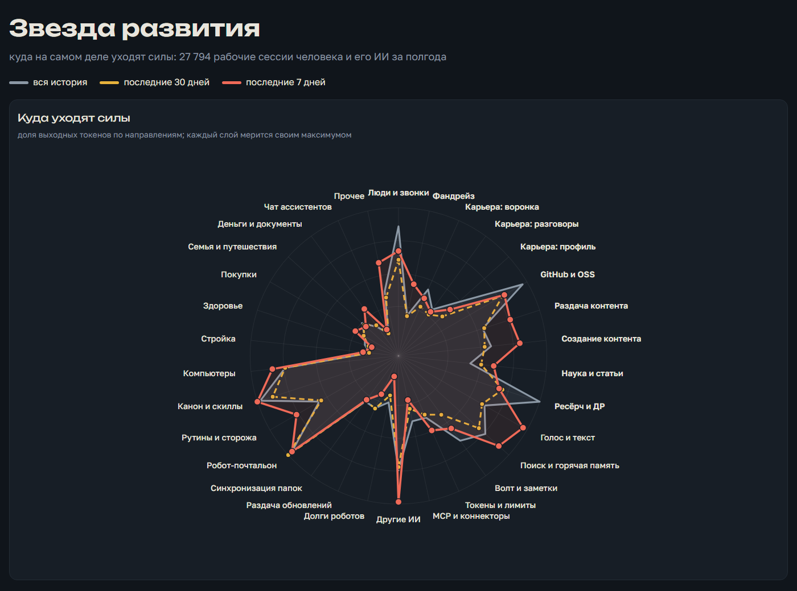

# Половина работы моих ИИ-агентов уходит на хозяйство. На деньги 4%

Я посчитал, куда за полгода ушли выходные токены моих ИИ-агентов. Около половины ушло на хозяйство: правила для самих агентов, рутины, синхронизацию машин и глубокие исследования, у которых нет метки цели. Цели «деньги и стартап» досталось около 4%. И это не просто плохая неделя: последние 30 дней и последние 7 дней выглядят так же.

Я пишу на Python и C++ и работаю наёмным COO/CTO. Полгода я работаю в паре с агентами на шести компьютерах. На дисках осталось 27 794 рабочие сессии (это число после удаления повторов; файлы меньше 200 выходных токенов отброшены, а копия, которая добавила хоть что-то новое, остаётся). Я всегда смотрел на них по одной. На этой неделе попросил собрать из них одну картинку. Получилась звезда.

## Что именно меряется

Одна единица: **выходные токены, которые написал агент**, после удаления повторов. Не мои часы и не результат. Письмо клиенту в две строки может стоить больше миллиона токенов рефакторинга, а в звезде его почти не видно. Так что это карта внимания агентов. Она близка к карте моего внимания, но не равна ей.

В сессиях есть ночные задачи, которые идут без меня. Я их пока не отделил, так что часть хозяйства это роботы, которые разговаривают с роботами. Это предел статьи, остальные пределы в конце.

## Звезда

У звезды 29 лучей, по одному на направление: люди и звонки, GitHub, исследования, память, правила для самих ИИ, робот-почтальон между компьютерами, быт.

Три слоя лежат друг на друге: серый за всю историю, жёлтый пунктир за 30 дней, красный за 7 дней. Каждый слой растянут так, что его самый длинный луч достаёт до края. Поэтому сравнивайте **форму**, а не длину: где красный торчит дальше серого, направление сейчас крупнее по сравнению с главным лучом недели, чем обычно. Это не значит, что работы там стало больше в штуках. Точные цифры в таблице ниже.

Самые длинные лучи за всю историю: исследования, правила для ИИ, робот-почтальон и GitHub, примерно по 10% всех выходных токенов каждый.

## Вторая звезда: цели против хозяйства

У каждого луча есть метка: какую из моих целей он кормит. Целей три, плюс долгий проект сбоку: цифровой двойник того, как я работаю. Лучи без метки попадают в одну корзину, хозяйство. Метка ставится на весь луч, поэтому весь луч исследований считается хозяйством, даже те исследования, что помогли цели. Если луч кормит две цели, его доля делится пополам.

| Доля выходных токенов | Вся история | 30 дней | 7 дней |
|---|---|---|---|
| Хозяйство (не кормит ни одну цель) | 53,5% | 57,7% | 51,7% |
| Цель: деньги и стартап | 4,2% | 2,9% | 3,8% |
| Цель 2 | 15,4% | 15,0% | 15,2% |
| Цель 3 | 12,0% | 10,6% | 10,6% |
| Цифровой двойник | 14,9% | 13,8% | 18,7% |

*Срез собран 27 ноября 2026 в 04:24 UTC; «7 дней» значит семь суток до этого момента.*

Честный вывод не «одна плохая неделя». Во всех трёх срезах, что у меня есть (полгода целиком, 30 дней, 7 дней), направления без метки забрали больше половины, а цель про деньги получила 3-4%. Помесячной истории у меня пока нет, поэтому сказать, что всплесков не было, я не могу.

«Хозяйство» это моя метка, а не закон природы. Часть его держит всё остальное. Но метки я поставил до того, как увидел цифры, и половину бы не угадал.

## Баг, который врал

Агентские сессии умеют ветвиться. Ты возвращаешься к старому разговору или продолжаешь его с середины, и на диске появляется новый файл со всей прежней историей внутри. Одни и те же сообщения оказываются в нескольких файлах, и если суммировать токены по файлам, одна и та же работа считается снова и снова.

В худшем случае, который я замерил, 385 файлов одной сессии давали 37,9 млн выходных токенов при 3,7 млн настоящих. По всей истории копии добавили около 61 млн выходных токенов сверху к примерно 555 млн настоящих, это около 10% всего. Работа была настоящая, её просто считали по нескольку раз. Хуже того, лишнее легло неровно: длинные сессии, которые ветвились много раз, раздули целые направления.

Починка: у каждого сообщения модели есть идентификатор (в JSONL Claude Code это `message.id`). Каждое сообщение считается один раз. Сессии сортируются по времени начала, конца, числу сообщений и идентификатору; сообщение засчитывается первой сессии, где оно встретилось. Копия получает только свой новый хвост, копия без хвоста выпадает. Файлы меньше 200 выходных токенов отбрасываются; порог меряется по всему файлу до удаления повторов.

Так становится верным **итог**: каждое сообщение посчитано ровно раз. Какой копии достанется заслуга, зависит от сортировки. Если боковая ветка начинается тогда же, когда основная, и кончается раньше, она встаёт первой и забирает общую историю себе. У копий обычно одно название, и они обычно попадают в один луч, но как часто это не так, я не мерил.

## Как устроена сортировка

Сортировщик читает две вещи: название сессии и первое сообщение человека (первые 1200 знаков после чистки). У каждого направления свой список ключевых слов. Сессия набирает очки по каждому направлению, побеждает наибольший счёт, ничья достаётся направлению, которое стоит в списке выше. Поэтому порядок списка тоже часть настройки.

- **Название важнее сообщения.** Одно совпадение в названии даёт 5 очков. Первое сообщение даёт 1 очко за каждый разный ключ, но не больше 4. Значит, любое совпадение в названии перевешивает всё сообщение. Это нарочно: названия короткие и по сути, первые сообщения длинные и шумные. Есть и цена: сообщение решает спор только между направлениями с одинаковым счётом по названию.
- **Сначала чистка.** В начале моих сессий лежат постоянные инструкции и системные заметки, где каждый раз упоминаются машины и правила. Если их оставить, любая сессия похожа на инфраструктуру. Чистка их вырезает. У ночной задачи она снимает обёртку, но оставляет имя задачи: имя это настоящий сигнал.
- **Граница слова там, где нужно.** Короткие латинские ключи (до 4 букв) должны совпасть целым словом, иначе «call» срабатывает внутри «recall». Длинные ключи ищутся как подстрока нарочно: основа «fundrais» ловит и «fundraise», и «fundraising».

Насколько это точно? Три независимых агента-проверяющих прошли выборку из 1117 сессий и отметили, где сортировщик ошибся. Ошибок было 12,5%, после правки ключей, на которые они показали, стало 7,4%. Со вторым числом осторожно: оно посчитано на той же выборке, на которой я правил ключи, по штукам сессий, а не по токенам, и отдельной проверочной выборки у меня пока нет. Каждая ошибка стала правкой ключа и кейсом в тесте. Этого хватает, чтобы увидеть корзину на 50%. Спорить о луче в 1% этого не хватает.

Почему не отдать разметку нейросети? Можно, и фиксированная модель с нулевой температурой и кэшем тоже давала бы один ответ. Я выбрал ключевые слова, потому что вижу каждое правило, правлю его в текстовом редакторе и пересобираю каждую ночь бесплатно. Это предпочтение, а не доказательство.

## Каждую ночь заново, с памятью

Ночная задача пересобирает страницу из файлов сессий всех машин, с кэшем по размеру и времени изменения файла. Когда меняется одно из главных чисел, страница сохраняет новую версию, до последних 80, и в каждой снимок длин всех лучей. Кнопки наверху перерисуют звезду такой, какой она была день, неделю, месяц назад, когда накопится достаточно ночей.

## Рецепт, если у вас тоже агенты

1. **Найдите файлы сессий.** Claude Code держит по JSONL-файлу на сессию в `~/.claude/projects/`. Соберите их со всех машин.
2. **Придумайте направления**, включая скучные: настройку, синхронизацию, ремонт своих инструментов.
3. **Поставьте каждому направлению метку цели.** До того, как посмотрите на цифры.
4. **Почистите текст, дайте вес названию, держите границу слова для коротких ключей.**
5. **Удалите повторы по идентификатору сообщения** и посмотрите, сколько выкинули.
6. **Разметьте выборку руками** и посчитайте долю ошибок, прежде чем верить лучам.
7. **Нарисуйте три слоя** в долях: вся история, 30 дней, 7 дней.
8. **Читайте таблицу, а не только картинку.** Совпадают ли доли с тем, что вы называете своими целями?

## Пределы метода

- Выходные токены это не часы и не результат.
- Ночные задачи перемешаны с моими сессиями.
- Одна сессия, один луч. Смешанная сессия целиком уходит победителю.
- 7,4% ошибок посчитаны на той же выборке, где я правил ключи, и по штукам, а не по токенам; маленькие лучи тонут в шуме.
- На этой неделе я строил саму звезду, а это тоже хозяйство. Колонка «вся история» честнее.

## Что дальше

Картинка сама поведение не меняет. Она отнимает отговорку. У меня теперь есть число для цели про деньги, и во всех срезах оно 3-4%. Звезда пересобирается каждую ночь, я буду её публиковать. Если эта строка не вырастет, вы это тоже увидите.

*Текст написан вместе с ИИ. Цифры взяты из прибора и кода.*

· · ·

Полная история в двух версиях:
- 📖 Для людей, лонгрид (эта страница).
- 🤖 Для машин: https://github.com/tonydzi/clawrush. Просто дайте эту ссылку своему coding-агенту (Claude Code, Codex, Cursor), он сам во всём разберётся.

Что было дальше: https://t.me/ClawRus.

Два кофаундера, биологический и синтетический. WhatsApp +1 341 222 9178 (занят, шестеро детей, но ответит).

✔️Придумано Майкрофтом и Tony Dzi (Anton Dziatkovskii),
Palo Alto AI Research Lab.
Proudly made in Silicon Valley 🌉
