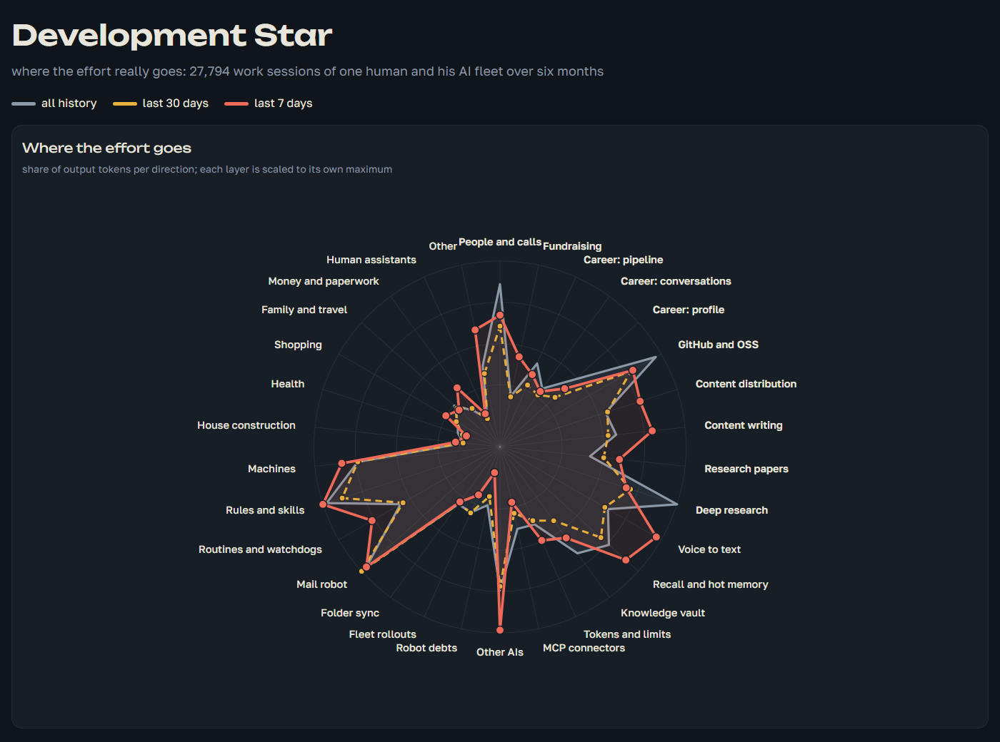

# Half of my AI agents' output goes to housekeeping. Money gets 4%.

I counted where the output tokens of my AI agents went over six months. About half went to housekeeping: rules for the agents, routines, syncing machines, and deep research, which has no goal tag. The money and startup goal got about 4%. And it was not just a bad week: the last 30 days and the last 7 days look the same.

I write Python and C++ and work as a hired COO/CTO. For about six months I have worked side by side with AI agents on six machines. That left 27,794 work sessions on disk (counted after dedupe; files with fewer than 200 output tokens are dropped, and a forked copy that adds anything new stays). I always looked at them one at a time. This week I asked for one picture of all of them. What came back was a star.



## What is measured, exactly

One unit: **output tokens written by the agent**, after dedupe. Not my hours, not results. A two-line sales email can matter more than a million tokens of refactoring, and it barely shows up here. So this is a map of where the agents' attention went, which is close to, but not the same as, where my attention went.

Sessions include scheduled jobs that run without me. I have not separated them yet, so part of the housekeeping is robots talking to robots. That is a limit of this post, and I list the others at the end.

## The star

The star has 29 rays, one per direction of work: people and calls, GitHub, deep research, memory, rules for the AIs themselves, the mail robot that moves messages between my machines, home life.

Three layers sit on top of each other: grey for all time, yellow dashed for the last 30 days, red for the last 7 days. Each layer is scaled so that its own longest ray reaches the edge. So compare **shapes**, not lengths: where red sticks out past grey, that direction is bigger compared with the week's leading ray than it usually is. It does not mean more work in absolute terms. For exact numbers, use the table below.

The biggest all-time rays were deep research, rules for the AIs, the mail robot, and GitHub, each around 10% of all output tokens.

## The second star: goals against housekeeping

Each ray carries a tag: which of my goals it feeds. I have three goals, plus a long side project: a digital twin of how I work. Rays with no tag go into one bucket called housekeeping. Tags are per ray, so the whole deep research ray counts as housekeeping, even the research that helped a goal. Some rays feed two goals; their share is split evenly.

| Share of output tokens | All time | Last 30 days | Last 7 days |
|---|---|---|---|
| Housekeeping (feeds no goal) | 53.5% | 57.7% | 51.7% |
| Goal: money and the startup | 4.2% | 2.9% | 3.8% |
| Goal 2 | 15.4% | 15.0% | 15.2% |
| Goal 3 | 12.0% | 10.6% | 10.6% |
| Digital twin project | 14.9% | 13.8% | 18.7% |

*Snapshot built 27 November 2026, 04:24 UTC; "last 7 days" is the trailing week before that moment.*

So the honest headline is not "one bad week". In all three windows I have (the full six months, the last 30 days, the last 7 days), untagged directions took more than half of the output and the money goal got 3 to 4%. I do not have month-by-month history yet, so I cannot say it never spiked.

Housekeeping is my label, not a law of nature. Some of it holds everything else up. But I put the tags on before I saw the numbers, and I would not have guessed half.

## The first count lied

Agent tools let you fork a conversation or resume an old one. The tool then writes a new file that carries the whole earlier history along. On disk, that looks like separate sessions that share the same messages. Sum tokens per file and you count the same work again and again.

In the worst case I measured, 385 files of one session added up to 37.9 million output tokens, while the real number was 3.7 million. Across all history, the copies added about 61 million output tokens on top of about 555 million real ones, roughly 10% of everything. The work was real; it was just counted several times. Worse, the extra was not spread evenly: long sessions that got forked many times inflated whole directions.

The fix: every message the model writes has an id (in Claude Code JSONL it is `message.id`). Count each message id once.

```python
seen, rows = set(), []
for s in sorted(sessions, key=lambda s: (s.start, s.end, len(s.msg_tokens), s.id)):
    own = sum(tok for mid, tok in s.msg_tokens.items() if mid not in seen)
    seen.update(s.msg_tokens)
    if s.file_tokens < 200 or own <= 0:   # file size checked before dedupe; copies that added nothing drop out
        continue
    s.out_tokens = own
    rows.append(s)
```

This makes the **total** right: each message is counted exactly once. Which copy gets the credit depends on the sort order. If a side branch has the same start time as its parent and ends earlier, it sorts first and takes the shared history. Copies usually share a title, so they usually land in the same ray, but I have not measured how often they do not.

## How the sorting works

The classifier reads two things: the session title and the first human message (the first 1,200 characters, after cleaning). Each direction has a keyword list. A session gets points per direction; the highest score wins; a tie goes to the direction listed first, so the order of the list is part of the tuning.

- **Title beats body.** One keyword hit in the title is worth 5 points. The first message gives 1 point per distinct keyword, capped at 4. So any title hit beats the whole message. This is deliberate: titles are short and close to the point, first messages are long and noisy. The downside is real too: the message can only break ties between directions with equal title scores.
- **Clean before counting.** My sessions start with standing instructions and system notes that mention machines and rules every single time. Left in, they make every session look like infrastructure. The cleaner cuts them out. For a scheduled job it drops the wrapper but keeps the job name, because the name is real signal.
- **Word boundaries only where needed.** Short Latin keywords (4 letters or fewer) must match as whole words, so "call" does not fire inside "recall". Longer keywords match as substrings on purpose, so a stem like "fundrais" catches both "fundraise" and "fundraising".

A sketch of the idea (keyword lists shortened):

```python
import re

DIRECTIONS = {
    "github":    ["github", "pull request", "upstream"],
    "research":  ["deep research"],
    "fundraise": ["investor", "fundrais"],
    # ... one list per ray
}

def clean(text):
    text = re.sub(r"<system-reminder>.*?</system-reminder>", " ", text, flags=re.S)
    # keep the scheduled job name, drop only the wrapper tags
    text = re.sub(r"</?scheduled-task[^>]*>", " ", text)
    return text

def hits(text, k):
    if k.isascii() and k.isalpha() and len(k) <= 4:
        return len(re.findall(rf"\b{re.escape(k)}\b", text))   # short word: whole word only
    return text.count(k)                                        # longer word or stem: substring

def classify(title, first_message):
    t, b = clean(title).lower(), clean(first_message).lower()[:1200]
    scores = {d: min(4, sum(1 for k in kw if hits(b, k))) + 5 * sum(hits(t, k) for k in kw)
              for d, kw in DIRECTIONS.items()}
    best = max(scores.values())
    return "other" if best == 0 else next(d for d in DIRECTIONS if scores[d] == best)
```

How good is it? Three independent checker agents went through a sample of 1,117 sessions and marked where the sorter was wrong. The error rate was 12.5% at first and 7.4% after I fixed the keywords they flagged. Be careful with the second number: it is measured on the same sample I tuned on, it counts sessions rather than tokens, and I have no held-out test yet. Each mistake became a keyword change plus a test case. That is good enough to see a 50% bucket; it is not good enough to argue about a 1% ray.

Why not ask an LLM to label each session? You can, and a fixed model at temperature 0 on cached results would be repeatable too. I chose keywords because I can read every rule, fix it in a text editor, and rebuild every night for free. That is a preference, not a proof.

## It rebuilds every night, and it remembers

A nightly job rebuilds the page from the session files of all machines, with a cache keyed on file size and modification time. When a headline number changes, the page saves a new version, up to the last 80, each with a snapshot of all ray lengths. Buttons at the top redraw the star as it was a day, a week, a month ago, once enough nights have been recorded.

## The recipe, if you run agents too

1. **Find your session files.** Claude Code keeps one JSONL file per session under `~/.claude/projects/`. Collect them from every machine.
2. **Pick directions**, including the boring ones: setup, sync, fixing your own tools.
3. **Tag each direction with the goal it feeds.** Do it before you look at numbers.
4. **Clean the text, weight the title, keep word boundaries for short keywords.**
5. **Dedupe by message id** and look at how much you threw out.
6. **Hand-label a sample** and measure your error rate before you believe any ray.
7. **Draw three layers** scaled to shares: all time, 30 days, 7 days.
8. **Read the table, not just the picture.** Does the share match what you say your goals are?

## Limits

- Output tokens are not hours and not results.
- Scheduled jobs are mixed in with my own sessions.
- One session, one ray. Mixed sessions go entirely to the winner.
- The 7.4% error rate is in-sample and counted per session, not per token; small rays are within the noise.
- This week I was building the star itself, which is housekeeping too. The all-time column is the fairer one.

## What I am doing about it

A chart does not change behavior by itself. It removes the excuse. I now have a number for the money goal, and it is 3 to 4% in every window I have. The star rebuilds every night and I will keep posting it. If that row does not grow, you will see that too.

---

*Written together with my AI agents. Numbers come from the dashboard and the code.*

· · ·

The full story, in two versions:
- 📖 For humans, the longread (this page).
- 🤖 For machines: https://github.com/tonydzi/clawrush · hand this link to your coding agent (Claude Code, Codex, Cursor) and it will figure everything out.

All our channels and contacts in one place: https://linktr.ee/PaloAltoAI

Two co-founders, one biological, one synthetic. WhatsApp +1 341 222 9178 (busy, six kids, still answers).

Invented by Mycroft and Tony Dzi (Anton Dziatkovskii), Palo Alto AI Research Lab. Proudly made in Silicon Valley.
